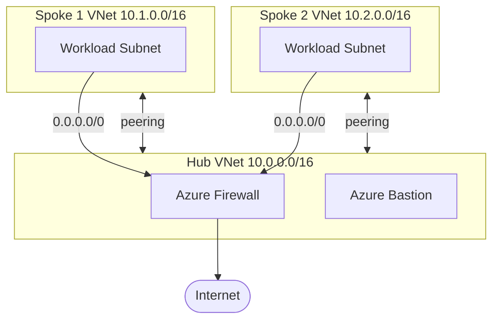

# Azure Hub-Spoke Network Topology (Terraform)

> Enterprise hub-spoke network on Azure: a central hub with Azure Firewall + Bastion, peered to workload spokes, with forced tunneling — provisioned with Terraform.
> **Author:** Muhammad Ahmad · **IaC:** Terraform · **Cloud:** Azure


---

## 📌 Overview

The standard **hub-spoke** pattern for segmenting workloads:

- A **hub VNet** hosts shared services: **Azure Firewall** (central egress/inspection) and **Azure Bastion** (secure RDP/SSH).
- Two **spoke VNets** hold workloads, **peered** to the hub.
- A **route table** on the spokes forces all outbound traffic (`0.0.0.0/0`) through the firewall.

This gives centralized security, logging, and controlled connectivity between environments.

## 🏗️ Architecture

> 🎨 **Interactive diagram (industry-standard icons):** [open in Lucid — page 11](https://lucid.app/lucidchart/3da75ce3-ea66-4296-81b3-00d20a60435b/edit)



## 🚀 Deploy

```bash
cd terraform
az login
terraform init
terraform apply
```

## 🧹 Clean up

```bash
terraform destroy
```

## 💰 Cost note

**Azure Firewall and Bastion are premium, hourly-billed services.** This is a reference topology — destroy it when you're done demoing.

## 🔐 Production hardening (next steps)

- Add **Firewall Policy** with application/network rule collections.
- Add **Azure Monitor / diagnostic settings** on the firewall.
- Add a **VPN/ExpressRoute gateway** in the hub for hybrid connectivity.

---

*Built and maintained by **Muhammad Ahmad**.*
