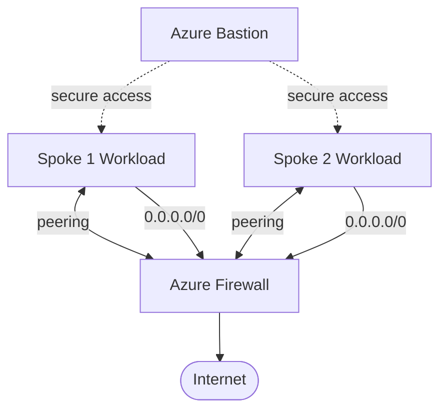

# Architecture Diagram — Azure Hub-Spoke Network

## Lucid diagram

- **View:** https://lucid.app/lucidchart/37739b1b-c69e-43ab-993d-f4eff821f322/view
- **Edit:** https://lucid.app/lucidchart/37739b1b-c69e-43ab-993d-f4eff821f322/edit

## Lucid prompt (reusable)

```
Create an Azure network diagram titled "Azure Hub-Spoke Network Topology".
A central Hub VNet contains Azure Firewall and Azure Bastion. Two Spoke VNets (Spoke 1,
Spoke 2) each contain a workload subnet and are peered to the hub (bidirectional).
The spokes route 0.0.0.0/0 to the Azure Firewall, which egresses to the Internet.
Clean, professional Azure colors.
```

## Mermaid source


